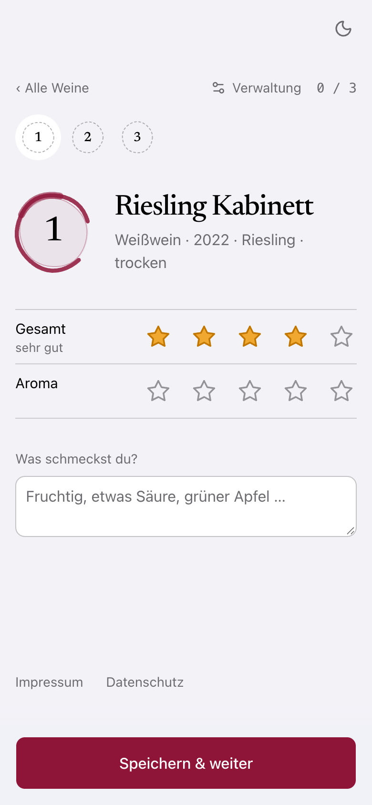
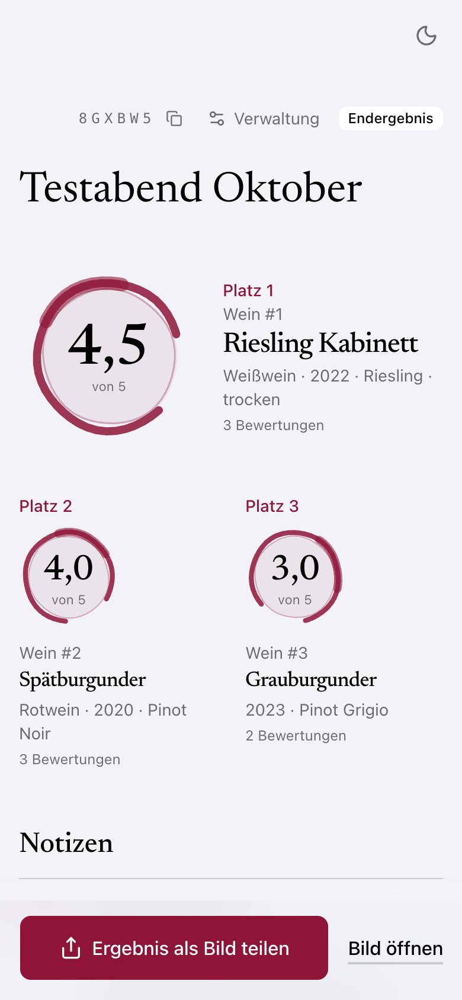
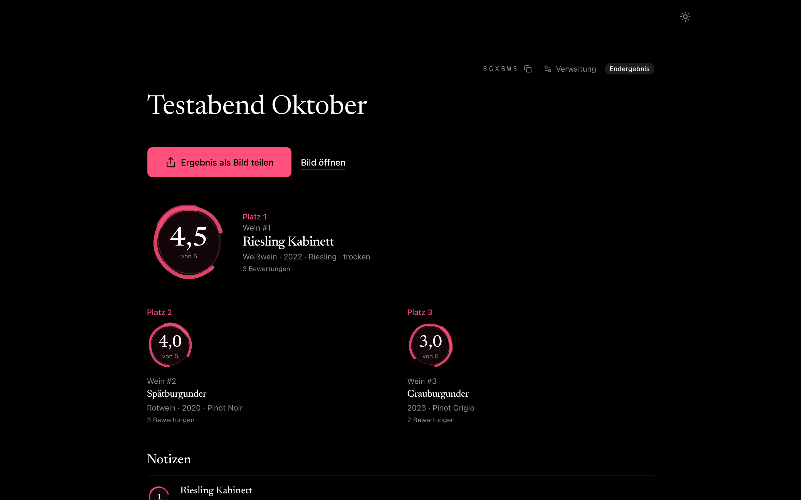

# 🍷 Wine Tasting

Webapp für private Weinverkostungen mit Freunden – gemacht fürs Handy am Tisch, mit Laptop- und Tablet-Ansicht für den Gastgeber.

Der Gastgeber erstellt ein Tasting, trägt die Weine ein und zeigt einen QR-Code. Gäste treten nur mit ihrem Namen bei – ohne Konto, ohne Passwort – und vergeben pro Wein und Kriterium 1–5 Sterne. Das Ranking läuft live mit; bei einer Blindverkostung erscheinen die Weinnamen erst am Ende.

<!-- Phone screenshots follow GitHub's light/dark theme -->

  <picture>
    <source media="(prefers-color-scheme: dark)" srcset=".github/screenshots/bewerten-dunkel.png">
    
  </picture>
  &nbsp;
  <picture>
    <source media="(prefers-color-scheme: dark)" srcset=".github/screenshots/ergebnis-dunkel.png">
    
  </picture>

## Funktionen

- **Tasting erstellen** mit Name, optionaler Beschreibung (steht unter dem Namen, z. B. Thema oder „Bring Brot mit“, später unter „Allgemein“ änderbar), optionaler Blindverkostung, Bewertungssystem und Admin-PIN
- **Bewertungssysteme:** Einfach (ein Gesamturteil), 5-, 20- oder 100-Punkte-Schema mit gewichteten Kriterien – die App erklärt, wie gerechnet wird
- **Weine** mit Name und Weinart (Pflicht) sowie Weingut, Jahrgang, Alkohol (% vol), Rebsorte, Geschmacksrichtung und einer freien Beschreibung wie „Süß & fruchtig“ (freiwillig); die Reihenfolge lässt sich auch während des Abends ändern; „Reihenfolge mischen“ mischt nur Weine, die noch niemand bewertet hat
- **Etikett scannen:** die App liest das Etikett direkt auf dem Gerät (das Foto wird nie hochgeladen), füllt sichere Angaben in leere Felder vor und bietet unsichere als Vorschlag zum Antippen an – vorbefüllte Felder sind markiert und müssen geprüft werden
- **Einladen** per QR-Code, Link oder 6-stelligem Code
- **Bewerten** mit Sternen und optionaler Notiz; auf dem Handy wischt man zwischen den Weinen
- **Ergebnisse** live mit Podest, Durchschnitt je Kriterium und – nach dem Ende – den Notizen aller Gäste ohne Namen
- **Rückblick** nach dem Ende, zugeklappt auf der Ergebnisseite: dein Favorit im Vergleich zur Gruppe, deine Noten neben den Durchschnitten der anderen, dazu der umstrittenste Wein und der, bei dem sich alle einig waren. Zu sehen sind nur deine eigenen Noten und Werte der Gruppe, Einzelnoten anderer nie mit Namen
- **Ergebnis als Bild** zum Teilen, z. B. in WhatsApp – mit Podest und allen Plätzen
- **Tisch-Ansicht** für iPad oder Fernseher: QR-Code zum Beitreten, Fortschritt, am Ende das Podest
- **Rückkehr-Link:** Neues Handy oder Cookies gelöscht? Der Gastgeber schickt dem Gast unter „Teilnehmer“ einen persönlichen Link, damit macht er auf jedem Gerät mit seinen Bewertungen weiter – bis zum Ende des Tastings; „Link sperren“ macht ihn ungültig
- **Verwaltung** mit PIN, auch vom Handy eines Gastes aus
- **Hell und dunkel**, folgt dem System oder per Schalter

## Datenschutz

Keine Konten, keine E-Mail-Adressen, keine Werbung. Gespeichert wird nur, was für den Abend nötig ist: die Weine, selbst gewählte Namen, Sterne und Notizen. Jedes Tasting wird 90 Tage nach dem Erstellen automatisch gelöscht, auf Wunsch auch früher. Etikett-Fotos werden nur auf dem Gerät ausgewertet und nie hochgeladen.

## Etikett scannen

Im Formular „Wein hinzufügen“ öffnet „Etikett scannen“ die Auswahl des Geräts: auf dem Handy Kamera, Fotos oder Dateien, am Laptop die Dateiauswahl. Die Texterkennung ([tesseract.js](https://github.com/naptha/tesseract.js)) läuft komplett im Browser, in sechs Sprachen (Deutsch, Englisch, Französisch, Italienisch, Spanisch, Portugiesisch). Erst beim ersten Scan werden Engine, Sprachdaten und Referenzlisten von der App selbst geladen: rund 10 MB, danach liegen sie im normalen Browser-Cache (ein Tag frisch, dann wird im Hintergrund geprüft). Tipp: den ersten Scan vor dem Abend im WLAN machen. **Das Foto bleibt auf dem Gerät.**

Der Parser (`src/lib/label`) sucht Jahrgang, Alkohol, Rebsorte, Weinart, Geschmacksrichtung, Name und Weingut. Er gleicht außerdem mit Listen in `public/data` ab: Weingüter, EU-Herkunftsbezeichnungen (z. B. „Chianti Classico“) und amtliche Weinlagen (Einzellagen, Rieden, Vigna). Der Grundsatz ist „lieber leer als falsch“:

- **Sichere Werte** (Faustregel: sehr wahrscheinlich richtig) landen in leeren Feldern. Diese Felder sind markiert (weinroter Rand und der Hinweis „vom Etikett – bitte prüfen“); die Markierung verschwindet, sobald du das Feld änderst oder „passt“ tippst. Bereits Getipptes wird nie überschrieben.
- **Unsichere Werte** werden nicht eingetragen, sondern unter dem Feld als „Vielleicht: …“ zum Antippen angeboten. Das gilt für Name und Weingut (mehrere Kandidaten), für eine Weinart, die nur aus der Rebsorte abgeleitet ist, und für Geschmackszeilen wie „SÜSS & FRUCHTIG“, die nur als Beschreibung vorgeschlagen werden.
- **Weinart und Rebsorte aus der Herkunft:** Was gedruckt auf dem Etikett steht, gewinnt immer; widersprechen sich Angaben, wird nichts eingetragen.
  - Weinart **sicher**: ein Weinart-Wort („Rotwein“, „Rosé“, „Sekt“), „Blanc de Noirs“/„Blanc de Blancs“ (Weißwein, auch bei roter Rebsorte; ein Sekt bleibt Sekt) oder eine Herkunft, die nur eine Farbe erlaubt (Chablis → Weißwein, Barolo → Rotwein). Die Herkunft zählt dafür nicht, wenn eine gedruckte Rebsorte farblich nicht passt (Barolo mit „Chardonnay“). Kurze Herkunftsnamen, die auch Orte sind („Dogliani“, „Aversa“), zählen nur groß gedruckt oder mit „DOC“, „AOC“, „Cru“ o. Ä.; im Kleingedruckten sind sie oft nur die Adresse.
  - Weinart **Vorschlag**: nur rote oder nur weiße Rebsorten auf dem Etikett („aus der Rebsorte“) oder in der Herkunft („aus der Herkunft“); bei roten und weißen gemischt gibt es keinen.
  - Rebsorte **sicher**: gedruckt, oder die Regeln der Herkunft verlangen mindestens 85 % einer Rebsorte (Barolo → Nebbiolo, Chablis → Chardonnay, Prosecco → Glera). Erlaubt die Herkunft zwei Farben mit verschiedenen Rebsorten (Sancerre: weiß Sauvignon Blanc, rot Pinot Noir), braucht es dafür die Farbe auf dem Etikett.
  - Rebsorte **Vorschlag**: bis zu drei typische Rebsorten einer Herkunft, die mehrere erlaubt (Rioja → Tempranillo, Chianti → Sangiovese), Hinweis „aus der Herkunft“.
- **Alkohol:** Nur eine als Alkohol gekennzeichnete Prozentzahl zählt („13,5 % vol“, „Alc. 13 %“, „13.5% ABV“), nicht „100 % Riesling“. Gut gelesen und eindeutig wird sie eingetragen. Nur vorgeschlagen wird sie bei zwei verschiedenen Werten, bei einer Obergrenze („alkoholfrei < 0,5 % vol“) und wenn direkt davor eine ein- oder zweistellige Zahl steht (die Texterkennung verliert manchmal das Komma: „13 5 % vol“); ein Jahrgang oder eine Füllmenge davor („2021 12,5 % vol“) stört nicht.
- **Jahrgang:** Steht noch eine andere Jahreszahl auf dem Etikett, die als Medaille, Prämierung oder Gründungsjahr aussortiert wurde, wird der verbliebene Jahrgang nur vorgeschlagen. Ein Etikett mit nur „2022“ füllt das Feld wie gewohnt.
- **Vorder- und Rückenetikett ergänzen sich:** Ein zweiter Scan füllt weitere leere Felder. Ein Feld, das der erste Scan gefüllt hat (noch markiert und unverändert), ersetzt er nur durch einen eigenen sicheren Wert; sonst bleibt der alte Wert samt Markierung stehen. Vorschläge gelten immer nur für das letzte Foto.
- Über dem Formular steht, solange etwas zu prüfen ist: „Vom Etikett gelesen – das kann falsch sein.“

**Genauigkeit:** Eine einmalige, von Hand ausgewertete Messung (November 2026, 25 Fotos: 5 eigene, 20 aus Open Food Facts) ergab: Jahrgang, Rebsorte, Weinart und Geschmacksrichtung waren nie falsch, wenn sie ausgefüllt wurden (Trefferquote je nach Feld 40–85 %, vieles steht schlicht nicht auf dem Etikett). Die Zahlen aktualisieren sich nicht von selbst und gelten für den Parser-Stand vom 11. November 2026, also vor späteren Korrekturen. Nachmessung mit den Regeln aus der Herkunft (12. November 2026, dieselben Fotos): weiterhin kein falscher sicherer Wert; sicher und richtig ausgefüllt jetzt Weinart 4 statt 3 und Rebsorte 9 statt 8 von 25 (auf den meisten Fotos ist die Herkunft nicht lesbar). Name und Weingut sind dagegen meist nur Vorschläge, weil Marke, Name und Abfüller auf Etiketten schwer zu trennen sind. Gute Ergebnisse brauchen ein scharfes, gerade und formatfüllend fotografiertes Etikett. Markierte Felder immer prüfen.

Die Listen neu erzeugen: `node scripts/build-wineries.mjs` und `node scripts/build-reference-data.mjs` (nur nötig, wenn sich Quellen ändern; die Ergebnisse liegen eingecheckt in `public/data`).

## Datenquellen & Lizenzen

Quellen und Lizenzen der mitgelieferten Daten stehen vollständig in [public/data/SOURCES.md](public/data/SOURCES.md) und im Impressum der App.

- **Texterkennung:** [tesseract.js](https://github.com/naptha/tesseract.js) und Sprachdaten aus [tessdata_fast](https://github.com/tesseract-ocr/tessdata_fast), Apache-2.0, selbst ausgeliefert aus `public/tesseract` ([README](public/tesseract/README.md)).
- **Weingüter:** © [OpenStreetMap-Mitwirkende](https://www.openstreetmap.org/copyright), [ODbL 1.0](https://opendatacommons.org/licenses/odbl/1-0/) (`craft=winery`); dazu [Wikidata](https://www.wikidata.org/), CC0 1.0.
- **Herkunftsbezeichnungen:** © Europäische Union, [eAmbrosia](https://ec.europa.eu/agriculture/eambrosia/geographical-indications-register/) (Weiterverwendung nach Beschluss 2011/833/EU). Typische Rebsorten aus [Wikidata](https://www.wikidata.org/) (CC0 1.0); Farbe und Hauptrebsorte (≥ 85 %) aus den amtlichen Produktspezifikationen (italienische Disciplinari des MASAF, französische Cahiers des charges des INAO), die Quelle steht je Eintrag in `public/data/appellations.json`.
- **Weinlagen Rheinland-Pfalz:** Weinbergsrolle Einzellagen, © Landwirtschaftskammer Rheinland-Pfalz (2020), [Datenlizenz Deutschland – Namensnennung – Version 2.0](https://www.govdata.de/dl-de/by-2-0), [Datensatz](https://weinlagen.lwk-rlp.de/), Daten verändert (nur Name, Ort, Region).
- **Weinlagen Niederösterreich:** Weinbau Rieden, © Land Niederösterreich, [CC BY 4.0](https://creativecommons.org/licenses/by/4.0/).
- **Weinlagen Südtirol:** © Autonome Provinz Bozen – Südtirol, Open Data, [CC0 1.0](https://creativecommons.org/publicdomain/zero/1.0/deed.de), Quelle trotzdem genannt.

## Tech-Stack

Next.js 16 (App Router, Server Actions) · TypeScript · Tailwind CSS 4 · shadcn/ui · Drizzle ORM · PostgreSQL · Zod · Vitest · PGlite · Playwright

Es gibt kein separates Backend: Seiten, Server-Logik und Datenbankzugriff laufen in Next.js. Der Browser spricht nie direkt mit der Datenbank.

## Selbst betreiben

- [DEVELOPMENT.md](DEVELOPMENT.md) – lokal starten, Tests, Projektstruktur, Sicherheit
- [DEPLOYMENT.md](DEPLOYMENT.md) – Vercel + Supabase oder Docker (z. B. auf dem Raspberry Pi)

## Lizenz

MIT – siehe [LICENSE](LICENSE).

Die mitgelieferten Dateien in `public/tesseract` (Texterkennung, Sprachdaten) und die Daten in `public/data` behalten ihre eigenen Lizenzen, siehe [public/tesseract/README.md](public/tesseract/README.md) und [public/data/SOURCES.md](public/data/SOURCES.md).
